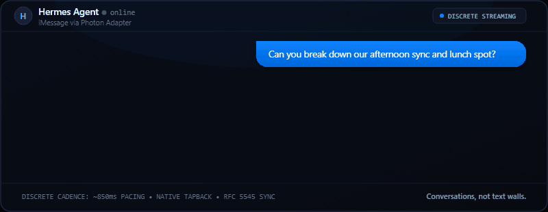
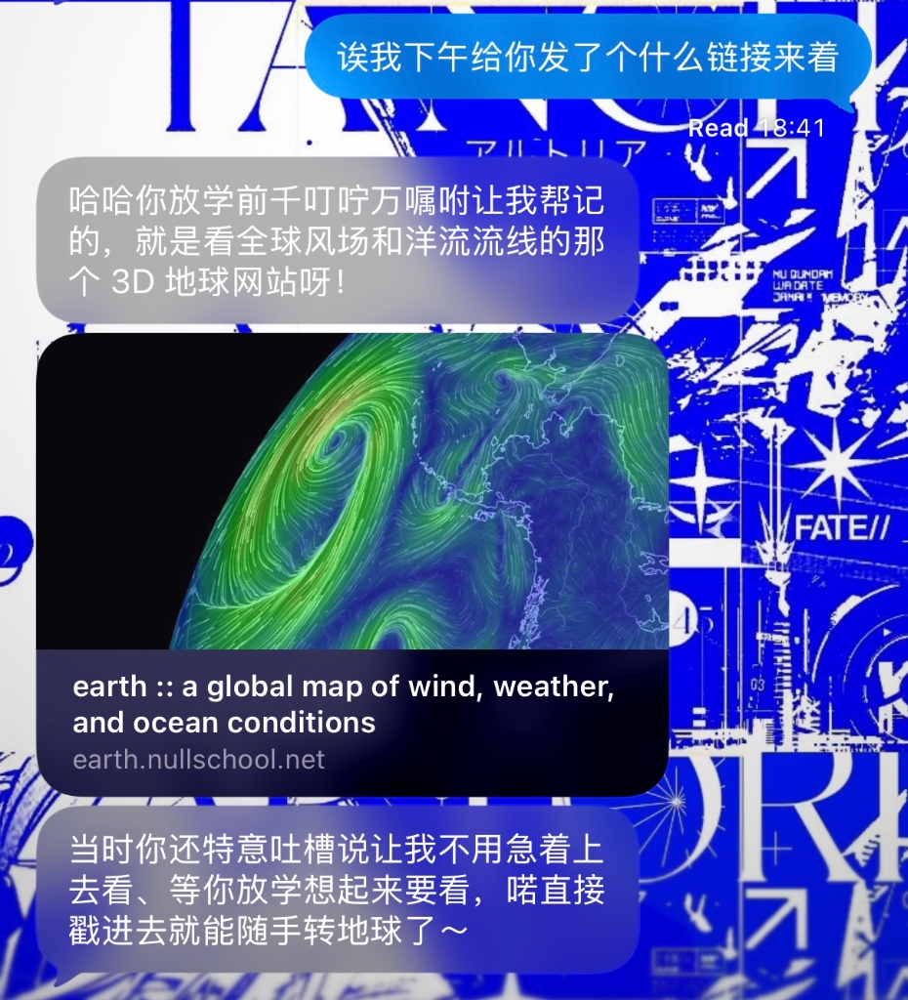

# AirHermes

**让 Hermes 的回复更像真正的 iMessage 对话。**  
[ 中文说明 ](README.md) • [ English ](README_EN.md)

<p align="left">
  <a href="https://github.com/DobyKoishi/AirHermes/releases"></a>
  <a href="#"></a>
  <a href="LICENSE"></a>
</p>

<p align="center">
  
</p>

---

## 核心特性

AirHermes 为 Hermes Agent 赋予原生的 iOS 会话体验与系统级交互能力：

- **离散气泡与拟人节奏**：基于语义标点（CJK 与西文终止符）自适应切分长文本，结合字数动态调节气泡间歇与原生打字指示器。
- **原生投票与轻量互动**：在会话流中直接发起可交互的 iMessage 多选投票组件，支持即时 Tapback 反应与全屏动效。
- **系统整合与安全外发**：原生生成 RFC 5545 标准日历邀请（`.ics`）、Apple Maps 导航卡片以及经白名单沙箱校验的富链接预览。

<details>
<summary><strong>查看原生交互实机截图 (Showcase Screenshots)</strong></summary>

<br/>

- **原生多选投票组件**：[查看原图 (assets/demo_poll.jpg)](assets/demo_poll.jpg)  
  <a href="assets/demo_poll.jpg"></a>

- **全屏动态特效与轻量反馈**：[查看原图 (assets/demo_screen_effects.jpg)](assets/demo_screen_effects.jpg)  
  <a href="assets/demo_screen_effects.jpg"></a>

- **系统级日程与导航**：[查看原图 (assets/demo_calendar_maps.jpg)](assets/demo_calendar_maps.jpg)  
  <a href="assets/demo_calendar_maps.jpg"></a>

- **富媒体链接卡片**：[查看原图 (assets/demo_rich_link.jpg)](assets/demo_rich_link.jpg)  
  <a href="assets/demo_rich_link.jpg"></a>

</details>

---

## 快速开始

AirHermes 通过经过验证的事务性安装器与 Hermes Agent 无缝集成。

### 兼容基线
本项目已针对以下固定的 Hermes 提交完成严格测试与兼容验证：
- 官方主干：`NousResearch/hermes-agent@242315ce571cde721e717a544cf8ae6c343315cf`
- 开发分支：`hermes-agent-fork@959902f4826b7efce4b79c181d5a2426c08287a0`

### 安装与诊断
```bash
# 1. 沙箱预检（验证环境与补丁适用性，不修改任何文件）
python install.py --target /path/to/hermes-agent --dry-run

# 2. 执行原子化事务安装
python install.py --target /path/to/hermes-agent

# 3. 运行环境健康诊断
python install.py --target /path/to/hermes-agent --doctor

# 4. 干净卸载还原（需要时还原至安装前原始状态）
python install.py --target /path/to/hermes-agent --uninstall
```

---

## 核心配置

在 Hermes 配置文件（`~/.hermes/config.yaml`）中按需配置核心流式参数：

```yaml
photon:
  airhermes:
    bubble_streaming: true        # 启用离散多气泡流式传输 (默认: true)
    bubble_min_interval: 0.85     # 气泡间最小延迟，单位秒 (默认: 0.85，范围: 0.2~5.0)
    bubble_adaptive_pacing: true  # 启用基于字数的拟人化动态节奏 (默认: true)
```

> **单轮不可变性保证**：配置在每轮会话开始时生成快照，会话执行过程中配置修改不会导致流式断流或节奏抖动。完整参数与环境变量请参阅 [docs/CONFIGURATION.md](docs/CONFIGURATION.md)。

---

## 交互协议规范

模型可在输出中直接使用以下标准化 XML 标签调用原生能力：

```xml
<!-- 1. 离散气泡显式分段 (Bubble Segmentation) -->
<bubble>已完成架构审查，正在为您生成日历邀请。</bubble>
<bubble>邀请已同步至系统日历，详情请查收附件。</bubble>

<!-- 2. 原生轻量互动与卡片 (Tapback & Polls) -->
<tapback action="love" target="last" />
<poll title="周五团建投票" options="莫干山, 安吉竹海, 乌镇" />
```

完整协议规范、支持的所有 XML 标签（`<effect>`, `<calendar>`, `<map>`, `<link>`）与容错剥离规则请参阅 [docs/PROTOCOL.md](docs/PROTOCOL.md)。

---

## 兼容性与运行边界

1. **上游基线绑定**：AirHermes 保证与上述固定 Commit 的二进制和补丁兼容性。未经测试的上游未来更新可能需要适配补丁。
2. **端到端实机投递**：本项目通过严格的 Mock 沙箱与集成测试保障逻辑正确性。实际向 iOS 设备投递原生消息需依赖用户本机 Photon 处于合法登录与授权状态。
3. **安全与隔离架构**：关于出站附件 MIME 白名单、路径遍历拦截与暂存隔离区机制，请参阅 [docs/SECURITY.md](docs/SECURITY.md)。

---

## 详细文档与许可证

- [配置完全手册 (docs/CONFIGURATION.md)](docs/CONFIGURATION.md)
- [交互协议规范 (docs/PROTOCOL.md)](docs/PROTOCOL.md)
- [安全与沙箱架构 (docs/SECURITY.md)](docs/SECURITY.md)
- [矢量动效原稿 (assets/airhermes-hero.svg)](assets/airhermes-hero.svg)
- [版本发布记录 (GitHub Releases)](https://github.com/DobyKoishi/AirHermes/releases)

本项目基于 [MIT 许可证](LICENSE) 开源。
