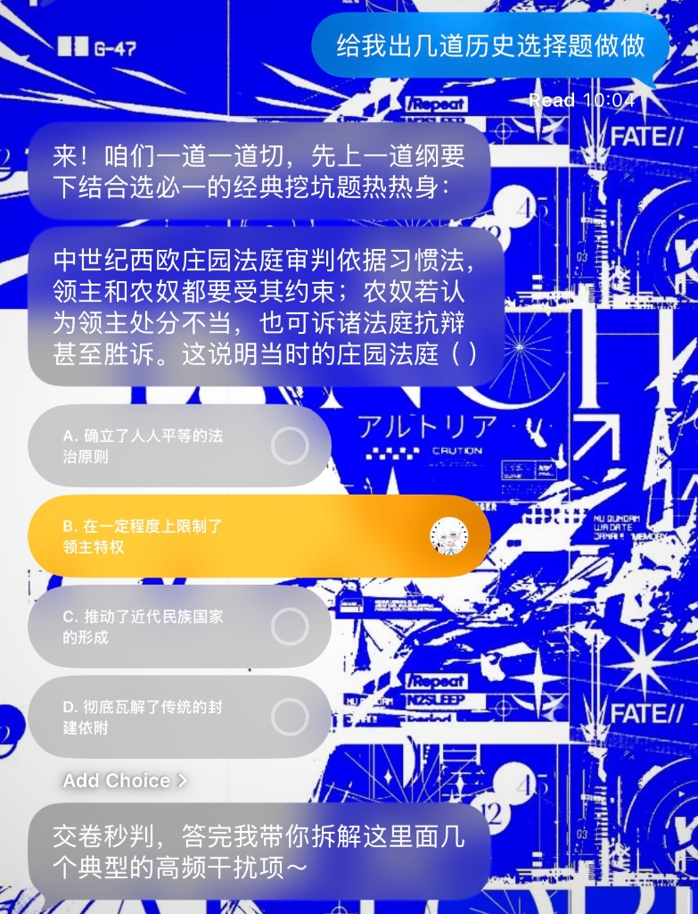

<div align="center">

# AirHermes

### 为 Hermes Agent 打造的原生 iMessage 离散气泡流与 iOS 交互套件

[](https://github.com/NousResearch/hermes-agent)
[-blue.svg?style=flat-square)](https://photon.sh)
[](https://python.org)
[](LICENSE)

<br />

**简体中文** &nbsp;|&nbsp; [English](README_EN.md)

</div>

---

Hermes Agent 原生的 Photon 通道默认将整段响应一次性发送。在手机或 Mac 端使用 iMessage 时，单条长消息既缺少对话交互的即时反馈，也无法调用 iOS 系统的原生富文本卡片。

AirHermes 是一个面向 Hermes Agent 的扩展套件，专为 iMessage (Photon) 运行环境设计。它将大模型回复切分为离散的短气泡，引入拟人化的打字节奏，并全面打通 iOS 原生生态协议 —— 包括可点选的投票卡片、Apple 日历事件、Apple Maps 地标微缩图、网页富媒体展开、全屏动效与 Tapback 表态。

---

## 演示效果

| 交互式原生投票 (`<poll>`) | 日历日程与 Apple Maps 地标 (`.ics` / `/place`) |
| :---: | :---: |
|  |  |
| **富媒体链接展开 (LPLinkView) 与上下文记忆** | **全屏动效 (Balloons) 与语义 Tapback 表态** |
|  |  |

---

## 体验对比

| 交互维度 | 默认表现 | AirHermes 优化 |
| :--- | :--- | :--- |
| **首字响应** | 深度思考或调用工具期间静止数秒，界面无响应 | 首句在 1 秒内给出即时口语反馈（如“收到，我来看下”），随后渐进推进 |
| **消息形态** | 一次性推送长篇 Markdown 排版文本 | 自动切分为 1~2 句话的离散短气泡，降低手机端长文本阅读压迫感 |
| **打字节奏** | 多条消息瞬间并发轰炸，触发通知堆叠 | 基于句长提供自适应间隔缓冲（300ms ~ 600ms），还原真实打字节奏 |
| **日程管理** | 纯文本时间信息，需手动复制录入 | 自动生成标准 UTF-8 BOM 编码的 `.ics` 原生卡片，点击即可一键存入 Apple 日历 |
| **地理位置** | 纯文本地名或无预览链接 | 生成 Apple Maps Unified Place URL，展示高清矢量路网微缩图，点击一键导航 |
| **互动测验** | 纯文本选择题 | 调用 iMessage 原生投票系统，支持多选项点选与头像标记 |
| **情绪互动** | 仅能输出常规文本 | 支持发送原生 Tapback（❤️、👍 等），可根据语境触发全屏气球、烟花、激光等动效 |

---

## 核心特性

- **离散气泡流式切分 (Bubble Parser)**  
  支持 `<bubble>` 标签式切分与无标签智能段落回退（Paragraph Fallback）。内置跨气泡代码块围栏状态机，防止代码块在流式切分时语法失衡或标记泄漏；自动修复中英文混排常见标点空格。

- **拟人化节奏队列 (Adaptive Pacer Queue)**  
  提供 5 态生命周期管理（Queued → Sending → Sent），在多气泡发送时实施基于语意长度的轻量节奏缓冲，兼顾即时性与阅读舒适度。包含断网重连保护与迟到 ACK 校验。

- **Apple Maps 统一地标规范 (/place)**  
  采用 Apple 官方最新的 Unified Place URL 规范 (`/place?coordinate=...&name=...&map=explore`)。iMessage 识别到坐标后在本地渲染出高清矢量卫星/路网视网膜微缩图；内置主流商圈城市坐标保底表，确保随时稳定触发卡片预览。

- **原生日历事件 (.ics)**  
  按 RFC 5545 规范输出无冗余哈希的干净文件名，加入显式 UTF-8 BOM 与字符集声明，杜绝在不同系统语言下的中文乱码问题。

- **交互式原生投票 (<poll>)**  
  在 Photon 驱动层打通 spectrum-ts 投票协议，无需第三方小程序或 Webview，直接在 iMessage 对话流内渲染原生选项与统计计数。

- **全屏系统动效与轻量表态**  
  支持 iMessage 原生全屏特效（气球、烟花、激光、彩带等）以及隐形墨水动效；支持不附带文本的纯 Tapback 表态。

---

## 协议标签规范

在系统提示词或自定义技能中，可直接输出以下轻量语义标签：

| 标签格式 | 功能说明 | 示例 |
| :--- | :--- | :--- |
| `<bubble>文本</bubble>` | 独立消息气泡 | `<bubble>下班去吃火锅不？</bubble>` |
| `<tapback>emoji</tapback>` | 原生 iMessage 表态 | `<tapback>❤️</tapback>`（支持 ❤️ 👍 👎 😆 ‼️ ❓） |
| `<poll title="...">` | 原生点选投票卡片 | `<poll title="周末去哪？"><option>海边</option><option>露营</option></poll>` |
| `<calendar title="..." start="..." />` | 原生 Apple 日历卡片 | `<calendar title="项目周会" start="2026-11-21 14:00" />` |
| `<map name="..." coordinate="..." />` | Apple Maps 地标卡片 | `<map name="旺角一兰拉面" coordinate="22.3193,114.1694" address="香港九龙旺角洗衣街88号" />` |
| `<contact name="..." phone="..." />` | 原生通讯录名片 (.vcf) | `<contact name="张三" phone="13800000000" />` |
| `<effect type="...">文本</effect>` | 全屏动效 | `<effect type="balloons">恭喜拿到了心仪的 offer！🎉</effect>` |
| `<invisible>文本</invisible>` | 隐形墨水气泡 | `<invisible>刮开查看答案</invisible>` |
| `<action title="..." shortcut="..." />` | 快捷指令跳转 | `<action title="记一笔账" shortcut="记账小助手" />` |

---

## 系统架构

```text
       LLM Incremental Delta Stream (Token 流)
                         │
                         ▼
┌──────────────────────────────────────────────────┐
│                   BubbleParser                   │
│   • 严格标签语法树 (<bubble>, <poll>, <map> 等)    │
│   • 跨气泡代码块围栏 (Code Fence) 自动平衡保护      │
│   • Apple Maps Unified Place 坐标与地名自动组装   │
│   • 无标签纯文本智能段落回退 (Paragraph Fallback)   │
└────────────────────────┬─────────────────────────┘
                         │
                         ▼
┌──────────────────────────────────────────────────┐
│              StreamingBubbleQueue                │
│   • 5 态生命周期管理 (Queued -> Sending -> Sent)  │
│   • 基于句长的自适应阅读节奏节流器 (Adaptive Pacer) │
│   • 迟到 ACK 对账与断网保护机制                     │
└────────────────────────┬─────────────────────────┘
                         │
                         ▼
┌──────────────────────────────────────────────────┐
│             Photon Platform Adapter              │
│   • 载荷分发：纯文本 / 投票 / 全屏动效 / 附件文件  │
│   • Node Sidecar 指数退避重试与 HEIC 原生转码     │
└────────────────────────┬─────────────────────────┘
                         │
                         ▼
           用户 iPhone / iPad / Mac iMessage
```

---

## 安装与配置

### 前置要求

1. 本地已安装 [Hermes Agent](https://github.com/NousResearch/hermes-agent)。
2. 已配置 iMessage (Photon) 账号：
   - 首次使用需在终端运行 `hermes photon setup` 扫码配对 Apple ID / 手机号。
   - 若本地已正常运行 Photon，可直接进行下一步。

### 一键安装

```bash
git clone https://github.com/<your-username>/AirHermes.git
cd AirHermes

# 自动检测本地 Hermes Agent 路径并注入补丁与模块（会自动备份被修改的文件）
python install.py
```

安装完成后，重启 Hermes 网关服务生效：

```bash
hermes gateway restart
```

### 卸载与恢复

如需完全恢复为 Hermes Agent 原始代码：

```bash
python install.py --uninstall
hermes gateway restart
```

---

## 目录结构

```text
AirHermes/
├── assets/                        # 演示实测截图
│   ├── demo_poll.jpg
│   ├── demo_calendar_maps.jpg
│   ├── demo_rich_link.jpg
│   └── demo_screen_effects.jpg
├── gateway/
│   ├── bubble_parser.py           # 离散多标签气泡解析器与段落回退引擎
│   ├── bubble_queue.py            # 5 态生命周期队列与抗断网自适应节奏引擎
│   └── bubble_stream_consumer.py  # Hermes 网关流式 Consumer 桥接器
├── plugins/platforms/photon/
│   ├── adapter.py                 # Photon 平台适配器（原生 iOS 动效/投票/表态）
│   └── sidecar/
│       ├── index.mjs              # 强化指数退避重试的 Node Sidecar
│       └── patch-spectrum-poll.mjs# spectrum-ts 投票鲁棒性补丁
├── patches/                       # 针对 Hermes 核心网关的标准 Git Patch
│   ├── hermes_all.patch           # 全量单文件补丁
│   ├── run_turn.patch
│   ├── run_turn_runner.patch
│   └── session.patch
├── tests/
│   └── test_photon_bubble_streaming.py  # 自动化测试套件
├── install.py                     # 一键安装、验证与卸载工具
├── README.md                      # 中文说明文档（默认）
└── README_EN.md                   # 英文说明文档
```

---

## 测试验证

运行独立单元测试以确认解析器与各协议行为正常：

```bash
python -m unittest tests/test_photon_bubble_streaming.py
```

---

## 开源协议

本项目采用 [MIT License](LICENSE) 开源。
